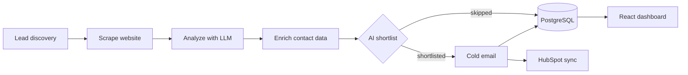
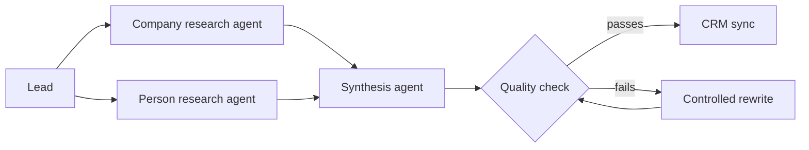

### I build the backends, pipelines and dashboards that put LLMs inside real workflows.

Python · FastAPI · PostgreSQL · LangGraph · Java · TypeScript
 
Vijayawada, India · Open to AI software engineer and backend roles

 

## About

I'm a 2026 graduate (B.Tech in Electronics & Communication Engineering, Data Science specialization, KL University, CGPA 8.39) working on the backend side of AI products. That means pipelines that collect and clean data, LLM agents that work through it in controlled steps, and the APIs and dashboards that let a person see what happened.

| Backend and APIs | AI agents | Data pipelines |
| :-- | :-- | :-- |
| FastAPI and Spring Boot services, REST design, async background jobs, JWT auth | LangGraph orchestration with typed state, structured outputs, retries and quality checks | Ingestion, extraction, enrichment and validation into PostgreSQL and MySQL |

 

## Projects

| Project | What it does | Stack | Links |
| :-- | :-- | :-- | :-- |
| **PipelineAI** | Finds leads, scrapes their sites, enriches the data, and emails the prospects an AI decision step shortlists | Python, FastAPI, PostgreSQL, LangGraph, React | [Live demo](https://pipelineai-dashboard.onrender.com/) · [Code](https://github.com/LokeshGaddam14/pipelineai) |
| **SalesIntelligenceAgent** | Three LangGraph agents research a company and a person, then write a summary that passes an automated quality check | Python, FastAPI, LangGraph, FastMCP, React | [Code](https://github.com/LokeshGaddam14/ai_sales_intelligence) |
| **delivr-engine** | Notification delivery with exponential backoff retries, audit logging and real-time analytics | Java, Spring Boot, MySQL, JWT | [Code](https://github.com/LokeshGaddam14/delivr-engine) |
| **approval-workflow-engine** | Leave and work requests from ready-made templates, routed up to higher ops for approval | TypeScript | [Code](https://github.com/LokeshGaddam14/approval-workflow-engine) |
| **ai-summarizer** | Paste a link, get a short AI summary of the page | JavaScript | [Live demo](https://ai-summarizer-peach-seven.vercel.app/) · [Code](https://github.com/LokeshGaddam14/ai-summarizer) |

> [!NOTE]
> The hosted PipelineAI demo can take about a minute to wake up on first load. PipelineAI here is my own project and is not affiliated with the PipelineAI company.

 

### PipelineAI

- Three-stage LangGraph pipeline (scrape, analyze, enrich) with typed state, structured JSON outputs and retry handling
- FastAPI backend with six REST endpoints and async background tasks that run the pipeline
- PostgreSQL storage for processed records, synced to HubSpot
- React and TypeScript dashboard for pipeline status, lead data, email previews and analytics

### SalesIntelligenceAgent

- Three LangGraph agents (company research, person research, synthesis) passing structured state with deterministic control flow
- Automated output-quality check with scoring, validation and a controlled rewrite step before anything moves downstream
- FastMCP server exposing five operational tools
- React and TypeScript dashboard showing live run status

 

## Tech stack

**AI and agents:** LangGraph, LangChain, RAG, ChromaDB, Groq, structured outputs, multi-agent orchestration, FastMCP
**Data and integrations:** Apify, Hunter.io, HubSpot API, n8n, Google APIs, SQLite
**Deploy:** Render, Vercel, Docker

 

## Other work

**Freelance automation, 2025 to present.** Built n8n and Python workflows for lead intake, qualification, enrichment, CRM sync and email notifications. Used Apify Google Maps extraction to build a sheet of 55 qualified dental clinic leads for field sales. Debugged live workflow failures, including mismatched payload fields and exposed credentials.

<b>Earlier data science projects</b> (Jupyter notebooks)

 

- [Bank loan default analysis](https://github.com/LokeshGaddam14/bank-loan-default-analysis)
- [Credit risk analytics](https://github.com/LokeshGaddam14/credit-risk-analytics)
- [Fraud detection](https://github.com/LokeshGaddam14/fraud-detection)
- [SaaS churn analysis](https://github.com/LokeshGaddam14/saas-churn-analysis)

**Certifications:** Google AI Professional Certificate, DeepLearning.AI Generative AI with LLMs.

 

**Want to talk about a role or a project? [Email me](mailto:lokeshgaddam2514@gmail.com) or message me on [LinkedIn](https://www.linkedin.com/in/lokesh-gaddam-ai-engineer/).**

